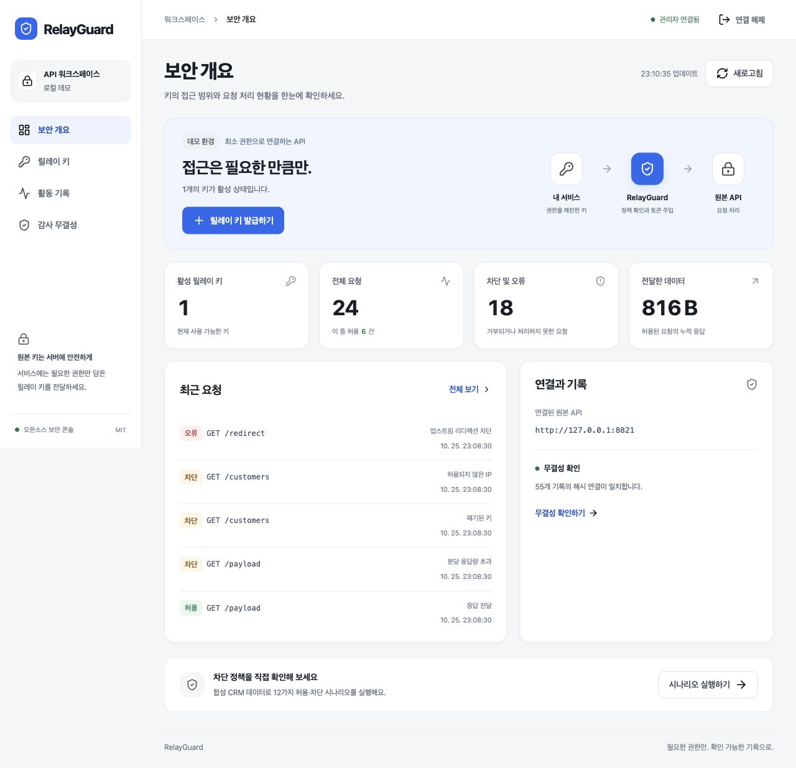

# RelayGuard

[English](README.en.md) · 한국어

**원본 API 토큰을 전달하지 않고, 연동별 접근 범위와 데이터 반출 한도를 제한합니다.**

RelayGuard is a self-hosted, scoped credential gateway for HTTP integrations. MIT licensed, with a Korean operations console and a local end-to-end demo.

2025~2026년 상용 서비스 사고를 조사해 **탈취된 연동 자격 증명으로 정상 API를 호출하고 데이터를 반출하는 문제**를 구현 범위로 정했다. 외부 연동에는 RelayGuard 키만 발급하고, 실제 서비스의 토큰은 게이트웨이 안에서만 사용한다. 모든 보안 사고를 막는 제품이나 기존 SaaS에 자동으로 설치되는 보안 에이전트는 아니다.

## 누구에게 적합한가

클라이언트의 API 주소와 인증 헤더를 바꿀 수 있고, 하나의 Bearer API에서 작은 JSON/텍스트 응답을 받는 내부 자동화에 적합하다. 계약자에게 짧게 쓰는 키를 주거나 배치 작업의 총 조회량을 제한하는 경우를 목표로 한다. 기존 게이트웨이에서 같은 정책을 운영 중이라면 별도 도구를 추가할 이점이 작을 수 있다.

**초기 공개 시험판**이다. 외부 도입 성과, 독립 보안 감사, 고가용성이나 처리량 보장은 아직 없다. 경쟁 도구와 도입 조건은 [시장 평가](docs/market-assessment.ko.md)에 정리했다.

## 바로 실행

Docker가 실행 중이면 공개 이미지를 받아 데모를 시작할 수 있다. GitHub 로그인이나 API 키는 필요 없다. `linux/amd64`와 `linux/arm64`를 지원한다.

```bash
docker run --rm -it --name relayguard-demo \
  -p 127.0.0.1:8810:8810 \
  --read-only --tmpfs /tmp:rw,noexec,nosuid,size=64m \
  --cap-drop ALL --security-opt no-new-privileges:true \
  --mount type=volume,source=relayguard-demo-data,target=/data \
  ghcr.io/kwakhyun/relayguard:0.2.0 \
  relayguard demo --host 0.0.0.0 --db /data/demo.db
```

1. [로컬 콘솔](http://127.0.0.1:8810)을 연다.
2. 터미널에 표시된 **데모 관리자 토큰**으로 연결한다. 토큰은 재시작할 때 바뀐다.
3. **데모 시나리오 실행**을 누른다. 실제 HTTP 요청 12건으로 정상 조회와 차단 결과를 확인한다.
4. 키를 발급해 직접 호출하고, 콘솔에서 폐기한 뒤 같은 키의 요청이 거부되는지 확인한다.

`Ctrl+C`로 종료한다. 같은 명령으로 다시 실행하면 `relayguard-demo-data` 볼륨의 릴레이 키와 감사 기록을 이어서 사용한다. 컨테이너 안에서는 합성 CRM에 loopback으로 연결하며, 호스트에는 콘솔 포트만 노출한다. 실제 개인정보나 외부 서비스 토큰은 사용하지 않는다.

[GHCR 패키지](https://github.com/users/kwakhyun/packages/container/package/relayguard)에는 `0.2.0`, `latest`, `sha-<commit>` 태그를 제공한다. 재현 가능한 실행에는 버전 태그나 [이미지 digest](docs/deployment.md#이미지-선택과-직접-빌드)를 사용한다.

### Python으로 실행

Python **3.11 이상**과 최초 설치 시 인터넷 연결이 필요하다.

```bash
git clone https://github.com/kwakhyun/relayguard.git
cd relayguard
python3 -m venv .venv
source .venv/bin/activate
python -m pip install -r requirements.lock
python -m pip install --no-deps --no-build-isolation -e .
relayguard demo
```

소스 체크아웃 없이 실행하려면 [v0.2.0 릴리스](https://github.com/kwakhyun/relayguard/releases/tag/v0.2.0)의 wheel을 가상환경에 설치할 수 있다.

```bash
python3 -m venv .venv
source .venv/bin/activate
python -m pip install 'https://github.com/kwakhyun/relayguard/releases/download/v0.2.0/relayguard-0.2.0-py3-none-any.whl'
relayguard demo
```

릴리스에는 wheel, 소스 배포본, 전체 프로젝트 ZIP, `SHA256SUMS.txt`가 포함된다. `SHA256SUMS.txt`는 다운로드된 파일의 일치 여부를 확인하는 체크섬이며 별도 서명을 뜻하지 않는다.

Python 데모는 기본적으로 `127.0.0.1:8810` 게이트웨이와 `127.0.0.1:8811` 합성 CRM을 실행한다. 사용 포트는 `--port`, `--upstream-port`로 바꿀 수 있다. 상태는 `.relayguard/demo.db`에 보관되며 콘솔 사용법과 종료 방법은 위와 같다.

## 콘솔 사용 흐름

v0.2.0 콘솔은 작업별로 네 화면으로 나뉜다.

| 화면 | 할 수 있는 일 |
| --- | --- |
| 보안 개요 | 활성 키와 요청 통계, 최근 요청, 원본 API 연결, 감사 상태 확인 |
| 릴레이 키 | 이름과 상태로 검색, 전체 정책 확인, 두 단계 발급, 대상 키 확인 후 폐기 |
| 활동 기록 | 허용, 차단, 오류 필터 및 불러온 최근 100건 안에서 검색 |
| 감사 무결성 | 해시 체인 검증, 현재 해시 복사, 전체 기록 JSON 내보내기 |

키를 발급할 때 먼저 접근 범위와 유효 시간을 정하고, 다음 단계에서 사용량과 IP 제한을 설정한다. 발급된 키는 한 번만 표시되므로 비밀 저장소에 보관한 뒤 저장 확인을 선택한다. 관리자 토큰과 발급된 키를 브라우저 저장소에 남기지 않으며, 페이지를 새로고침하면 다시 연결해야 한다.



## 구현한 통제

| 통제 | 실제 동작 |
| --- | --- |
| 자격 증명 분리 | 256비트 난수 릴레이 키를 한 번만 표시한다. DB에는 SHA-256 해시만 저장하고, 실제 서비스 Bearer 토큰은 서버 설정에서 주입한다. |
| 기본 거부 | 키마다 메서드, 경로, 허용 쿼리 키, 선택적 IP/CIDR을 지정한다. 다른 경로와 요청 변형은 서비스 호출 전에 거부한다. |
| 지속되는 제한 | UTC 고정 1분 창과 선택적 키 수명 전체의 호출 수, 응답 바이트를 SQLite 트랜잭션으로 제한한다. 여러 워커와 동시 요청도 동일 DB의 한도를 공유한다. |
| 반출 전 검사 | 응답 하나의 크기와 누적 바이트 한도를 확인할 때까지 전체 응답을 보류한다. 초과 응답의 앞부분도 보내지 않는다. |
| 만료와 폐기 | 만료, 폐기 상태를 요청 예약과 응답 바이트 승인 시 재확인한다. 데이터베이스와 감사 기록 실패 시 응답을 차단한다. |
| 안전한 프록시 | 고정된 HTTPS origin에만 연결한다. 리디렉션, 압축 응답, HTML, 쿠키, 전달 헤더, 공유 클라이언트 인증의 재사용을 막는다. |
| 감사 | 허용/거부 사유, 정책 경로 템플릿, 상태와 바이트 수를 기록한다. 해시 체인 검증과 JSON 내보내기를 제공한다. 본문, 쿼리 값, 토큰 원문은 기록하지 않는다. |
| 운영 콘솔 | 실제 통계, 키 발급과 폐기, 이벤트 필터, 감사 검증, 데모 실행. 관리자 토큰은 브라우저 메모리에만 둔다. |

## 왜 이 문제인가

- **Composio, 2026년 5월:** 고객 자격 증명 침해 후 원본 토큰 미반환, 프록시 실행, 키 해시 저장과 IP 제한을 도입했다. [공식 보고](https://composio.dev/blog/composio-may-2026-security-incident)
- **Salesloft Drift, 2025년 8월:** 탈취한 OAuth 토큰으로 Salesforce 데이터를 추출하고 그 안에서 추가 비밀을 탐색했다. [Google GTIG 분석](https://cloud.google.com/blog/topics/threat-intelligence/data-theft-salesforce-instances-via-salesloft-drift)
- **Klue, 2026년 6월:** 공급망 침입이 운영 워크로드와 연동 토큰 접근으로 이어졌다. [공식 기술 회고](https://klue.com/blog/what-a-security-incident-taught-us-about-securing-a-modern-saas-platform)

공식 사고 6건, 기사 2건, 기술 표준, 날짜 구분과 요구사항 연결은 [한국어 조사 보고서](docs/research.ko.md)에 정리했다. 자료가 이 프로젝트의 효과를 검증한 것은 아니다.

## 데이터 흐름

```text
연동 클라이언트                         운영자
  제한된 릴레이 키                       관리자 토큰
       │                                    │
       ▼                                    ▼
 /proxy/* ── 인증 → 경로/쿼리/IP 정책    /api/* + 콘솔
                    │                       │
             SQLite 호출 예약 ◀──── 발급 / 만료 / 폐기
                    │
             고정 HTTPS upstream
             (서버 전용 토큰 주입)
                    │
             응답 전체 크기 검사
                    │
       SQLite 바이트 승인 + 감사 기록
                    │
             클라이언트로 전달
```

Python/FastAPI, HTTPX, SQLite, 빌드 과정이 없는 JavaScript/CSS로 구성했다. 런타임은 지정한 upstream 외에 별도의 클라우드 API나 텔레메트리에 연결하지 않는다. 한 배포 인스턴스는 하나의 upstream origin과 하나의 서비스 계정을 담당한다.

## 키 발급 및 호출

콘솔을 사용하거나 [예제 정책](examples/read-only-policy.json)으로 발급한다. `RELAYGUARD_ADMIN_TOKEN`에는 현재 서버의 관리자 토큰을 설정한다. 아래 예제의 IP 제한은 Python loopback 실행용이다. 호스트에서 Docker 데모를 호출할 때는 `examples/docker-demo-policy.json`으로 바꾼다. 이 Docker 예제는 호스트 loopback 포트에 게시된 합성 데모용이며 운영 IP 정책을 대신하지 않는다.

```bash
curl -sS http://127.0.0.1:8810/api/credentials \
  -H "Authorization: Bearer $RELAYGUARD_ADMIN_TOKEN" \
  -H 'Content-Type: application/json' \
  --data-binary @examples/read-only-policy.json
```

응답의 `token`은 다시 조회할 수 없다. 안전하게 보관한 값을 `RELAY_TOKEN`으로 설정한다.

```bash
curl -sS 'http://127.0.0.1:8810/proxy/customers?limit=2' \
  -H "Authorization: Bearer $RELAY_TOKEN"
```

경로 `*`는 **한 개의 비어 있지 않은 세그먼트**만 허용한다. `/customers/*`는 `/customers/123`을 허용하고 `/customers/123/export`는 거부한다. 일치하는 규칙 중 와일드카드가 가장 적은 규칙을 적용하고, 같으면 선언 순서를 따른다. 쿼리 키의 허용은 값이나 업무 의미의 검증을 뜻하지 않는다. [API 명세](docs/api.md)에 모든 요청과 반환 코드를 설명했다.

## 연동 전 정책 검사

실제 토큰이나 네트워크 연결 없이 발급 JSON과 허용/거부 사례를 검사한다. 실패 시 종료 코드 1을 반환하므로 CI에 넣을 수 있다.

```bash
relayguard policy check examples/read-only-policy.json --cases examples/policy-cases.json
```

이는 경로, 메서드, 쿼리, IP 정책 검사다. 만료, 실제 사용량과 upstream 동작은 실행 중에 검증한다. [예제 설명](examples/README.md)에 Docker peer 차이와 검사 범위를 정리했다.

## 테스트와 재현

```bash
python -m pip install -r requirements-dev.lock
python -m pytest -q
python scripts/e2e.py
python -m build --no-isolation
python scripts/wheel_smoke.py
# 콘솔 회귀 검사: Node.js 24 사용
npm ci
npm test
```

`scripts/e2e.py`는 임시 DB와 임의 포트에서 별도 서버 프로세스를 실행해 12개 데모 시나리오와 별도 누적 한도 검사, 준비 상태, 인증 경계, 감사 체인을 확인한 뒤 종료한다. 로컬 소켓 사용 권한이 필요하다. 단위 테스트만으로 통과한 것으로 표시하지 않는다. 실행 기록과 확인 범위는 [검증 보고서](docs/verification.md)에 있다.

GitHub Actions의 `verify` 워크플로는 Python 3.11, 3.12, 3.13에서 테스트, 실제 HTTP 시나리오, 패키지 빌드, 알려진 런타임 의존성 취약점 검사를 수행한다. 각 Python 버전에서는 별도 환경에 설치한 wheel을 확인하고, Python 3.12 작업에서는 콘솔 비동기 회귀 검사도 실행한다. 원격 실행 결과는 [Actions](https://github.com/kwakhyun/relayguard/actions/workflows/ci.yml)에서 확인한다.

[컨테이너 워크플로](https://github.com/kwakhyun/relayguard/actions/workflows/container.yml)는 amd64와 arm64 러너에서 이미지를 빌드하고 실행 검증한다. 버전 태그에서는 Python 검증까지 통과해야 GHCR에 게시한다. [공개 이미지 검증](https://github.com/kwakhyun/relayguard/actions/workflows/container-public.yml)은 레지스트리 로그인 없이 내려받은 이미지를 실행한다. 실행 결과와 빌드 digest는 해당 워크플로에서 확인한다.

## 운영에 연결

```bash
export RELAYGUARD_UPSTREAM_URL='https://your-api.example.com'
export RELAYGUARD_UPSTREAM_TOKEN='replace-with-provider-token'
export RELAYGUARD_ADMIN_TOKEN="$(docker run --rm \
  ghcr.io/kwakhyun/relayguard:0.2.0 relayguard generate-admin-token)"

docker run -d --name relayguard --restart unless-stopped \
  -p 127.0.0.1:8810:8810 \
  --env RELAYGUARD_UPSTREAM_URL --env RELAYGUARD_UPSTREAM_TOKEN \
  --env RELAYGUARD_ADMIN_TOKEN \
  --read-only --tmpfs /tmp:rw,noexec,nosuid,size=64m \
  --cap-drop ALL --security-opt no-new-privileges:true \
  --mount type=volume,source=relayguard-data,target=/data \
  ghcr.io/kwakhyun/relayguard:0.2.0
```

관리자 토큰은 안전하게 보관해 콘솔 로그인에 사용한다. 예제의 원본 토큰은 실제 비밀 저장소에서 주입한다. 이미지는 UID/GID `10001:10001`로 실행되며 DB를 `/data/relayguard.db`에 보관한다. 일반 모드에는 데모 실행 기능이 없다.

저장소의 `compose.yaml`도 같은 공개 이미지를 사용한다. 위 세 환경변수를 설정한 뒤 저장소 디렉터리에서 실행한다.

```bash
docker compose pull
docker compose up -d
```

Compose는 `.env`를 자동으로 읽지만 Python CLI는 읽지 않는다. 외부 공개 전 TLS와 접근 제어를 구성한다. 직접 TLS, Python 배포, 볼륨 관리와 로컬 이미지 빌드는 [배포 지침](docs/deployment.md)에 설명했다.

## 보호 범위와 남은 한계

- 외부 연동이 **원본 서비스 토큰을 보유하지 않고 이 게이트웨이를 통과할 때**만 정책이 적용된다. 원본 토큰 유출 시 제공자 측 회전과 접근 제한이 필요하다.
- 허용된 데이터는 정해진 한도 안에서 유출될 수 있다. 객체/테넌트 권한, GraphQL/SQL 의미 분석, 개인정보 탐지, 피싱, RCE, 공급망 감염을 해결하지 않는다.
- 분당 제한은 **고정 1분 창**이라 분 경계 전후에 두 창의 예산이 사용될 수 있다. `max_total_requests`와 `max_total_bytes`를 설정하면 키 수명 전체의 누적 한도도 적용된다. 생략하면 누적 한도는 없으며 여러 키의 합산 조직 한도는 없다.
- 이미 upstream에 전달된 쓰기 작업은 취소하지 못한다. 폐기는 요청 예약과 응답 승인 시 검사하며, 최종 승인 이후 전송 중인 응답을 소급 중단하지 않는다. 기본 예제는 읽기만 허용한다.
- 감사 해시 체인은 변경 흔적을 확인하는 기능이다. DB 전체 재작성, 마지막 기록 삭제, 전체 롤백은 외부 기준점 없이는 증명하지 못한다. 내보낸 로그와 head hash를 별도 신뢰 저장소에 보관해야 한다.
- 초기 버전은 단일 관리자 비밀, 하나의 upstream, 로컬 SQLite를 사용한다. SSO/RBAC, OAuth refresh, KMS, 다중 리전, 조직 전체 예산과 자동 토큰 회전은 구현하지 않았다. 인터넷 규모의 DDoS 방어와 성능 보장은 제공하지 않는다.

추가 신뢰 경계와 실패 동작은 [위협 모델](docs/threat-model.md)을 참조한다.

## 오픈소스

[MIT License](LICENSE). [기여 안내](CONTRIBUTING.md), [보안 제보 절차](SECURITY.md), [변경 기록](CHANGELOG.md).

[GitHub 저장소](https://github.com/kwakhyun/relayguard)에서 소스와 이슈를 관리하고, [Releases](https://github.com/kwakhyun/relayguard/releases)에서 설치용 패키지를 배포한다. 이 저장소의 공개는 실제 고객 데이터나 서비스에 대한 운영 배포를 의미하지 않는다.
